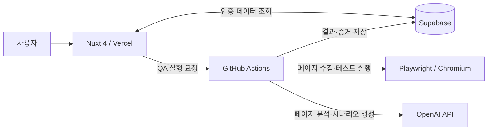

# Probe QA

**URL 기반 AI 웹 QA 자동화 플랫폼**  
웹페이지를 분석해 테스트 시나리오를 생성하고, 실제 브라우저에서 실행한 결과와 검증 근거를 관리하는 프로젝트입니다.

[서비스 보기](https://scenario-qa-app.vercel.app) · [애플리케이션 코드](./scenario-qa-app) · [Playwright 실행기](./scenario-test-runner)

## 프로젝트 소개

반복적인 웹사이트 검수 과정에서 테스트 시나리오 작성, 브라우저 실행, 실패 원인 확인을 연결하기 위해 개발했습니다. **AI는 페이지 분석과 테스트 시나리오 생성에 활용하고, 테스트의 실행·성공 여부 판정은 Playwright와 검증 조건을 통해 처리**하도록 구성했습니다.

## 주요 기능

- **AI 기반 페이지 분석 및 테스트 시나리오 생성:** 웹페이지의 요소·상태·기능을 분석하고 검토 가능한 테스트 시나리오를 생성
- **기능 QA 자동화:** 생성된 시나리오를 검토·수정하고 Playwright로 테스트를 실행해 결과를 기록
- **UI QA:** 규칙 기반 화면 점검, 선택적 디자인 비교, 증거 스크린샷 수집
- **검수 및 이슈 관리:** 실행 결과 검토, 결함 등록, 결과 필터링 및 Excel 보고서 내보내기

## 기술 스택

| 구분 | 기술 | 활용 |
| --- | --- | --- |
| Frontend | Nuxt 4, Vue 3, TypeScript, SCSS | 사용자 화면과 QA 관리 인터페이스 |
| AI Integration | **OpenAI API**, OpenAI SDK, Zod | 페이지 분석·시나리오 생성, JSON Schema 기반 응답 및 데이터 검증 |
| Test Automation | Playwright, Chromium | 브라우저 자동 실행, 단계별 검증 및 실행 증거 수집 |
| Database & Auth | Supabase | 인증, 데이터 저장 및 실행 결과 조회 |
| Infrastructure | Vercel, GitHub Actions | 웹 애플리케이션 운영 및 별도 QA 실행 워크플로 |
| Development Tools | **OpenAI Codex**, Git | AI 지원 개발 및 코드 관리 |

> **OpenAI API**는 서비스 기능에 연동된 기술이며, **Codex**는 프로젝트 개발에 활용한 AI 코딩 도구입니다. 두 역할을 구분해 표기했습니다.

## 아키텍처



웹 요청 처리와 브라우저 자동화 실행을 분리했습니다. Vercel의 Nuxt 애플리케이션은 인증·조회·실행 요청을 처리하고, GitHub Actions에서 페이지 분석 및 Playwright 작업을 실행합니다.

## 프로젝트 구조

```text
.
├── scenario-qa-app/       # Nuxt 4 웹 애플리케이션, API 및 QA 작업 스크립트
├── scenario-test-runner/  # 독립적인 Playwright 시나리오 실행기
├── .github/workflows/     # QA 실행 및 운영 워크플로
├── design/                # 디자인 가이드 및 화면 참고 자료
└── ai-web-qa-mvp-design.md
```

## 로컬 실행

웹 애플리케이션 기준입니다. 전체 QA 워크플로 실행에는 별도의 Supabase 설정, OpenAI API 키 및 GitHub Actions 설정이 필요합니다.

```bash
cd scenario-qa-app
npm install
cp .env.example .env
npm run dev
```

`.env`에 필요한 개발 환경 값을 설정한 뒤 실행합니다. 자세한 환경 구성과 운영 방법은 [애플리케이션 README](./scenario-qa-app/README.md) 및 [배포 가이드](./scenario-qa-app/docs/DEPLOYMENT_VERCEL_GITHUB_SUPABASE.md)를 참고하세요.

```bash
npm run typecheck
npm test
npm run build
```

**보안:** API 키, Supabase 서비스 역할 키, GitHub 토큰은 서버·실행 환경의 비밀 값으로 관리하며 공개 저장소나 클라이언트 환경변수에 포함하지 않습니다.
