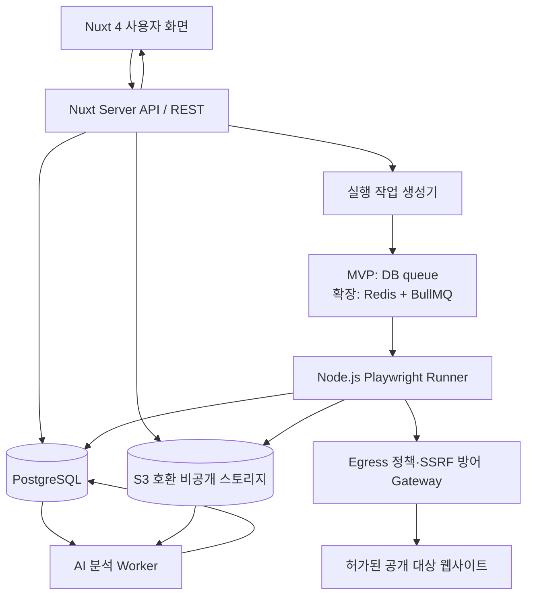

# AI 기반 웹 테스트 자동 검증 SaaS — MVP 기획·기술 설계서

문서 버전: 1.0  
작성 기준일: 2026-07-31  
대상 독자: 제품 기획, QA, 프론트엔드, 백엔드, 테스트 자동화, 인프라·보안 담당자

## 전제와 의사결정

- **MVP의 검증 대상은 사용자가 테스트 권한을 가진 공개 웹사이트**로 제한한다. 사내망·로컬·사설 IP 대상은 보안상 차단한다.
- **성공/실패 판정은 Playwright와 명시적 assertion이 담당**한다. AI의 해석은 판정 근거가 아니라 시나리오 구조화·후보 추천·사후 분석에만 사용한다.
- **MVP는 Chromium 1종, 단일 탭, 한 시나리오당 최대 50단계, 최대 10분**을 기본 제한으로 둔다.
- **모바일은 네이티브 앱이 아니라 모바일 브라우저 viewport 에뮬레이션**을 뜻한다.
- **4주 일정은 풀스택 개발자 1명, 실행 엔진/백엔드 개발자 1명, 파트타임 QA·기획 1명**을 가정한다. 1인 전담이면 같은 범위를 6~8주로 보는 것이 현실적이다.
- 인증은 MVP에서 외부 인증 서비스 또는 Supabase Auth를 사용한다고 가정한다. 조직·초대·세부 역할 관리는 MVP에서 제외하고 데이터 소유자 기준 권한만 제공한다.
- 우선순위 표기: **P0** 출시 필수, **P1** MVP 안정성에 중요, **P2** 출시 후 확장.

---

## 1. 서비스 한 줄 소개

**비개발자도 자연어 테스트 시나리오를 등록하면, 실제 브라우저가 웹사이트를 실행·검증하고 증거와 원인 분석을 제공하는 AI 보조형 웹 QA 자동화 SaaS.**

## 2. 해결하려는 문제

현재 웹 검수는 문서의 테스트 케이스를 사람이 읽고, 화면을 클릭하며, 결과를 수기로 기록하는 경우가 많다. 이 방식은 다음 문제를 만든다.

1. 반복 검수 비용이 크고 담당자마다 실행 품질이 다르다.
2. 실패 당시 화면·콘솔·네트워크 증거가 일관되게 남지 않는다.
3. 비개발자는 Playwright/Cypress 코드를 작성하거나 유지하기 어렵다.
4. 자연어 문서와 자동화 코드가 분리되어 변경 사항이 빠르게 반영되지 않는다.
5. “기능 결함”, “선택자 변경”, “테스트 환경 문제”, “실행기 오류”가 한데 섞여 원인 파악이 늦어진다.

MVP는 자연어를 검토 가능한 구조화 단계로 변환하고, 브라우저 실행과 결과 판정을 코드로 자동화하며, 실패 증거를 한곳에 모아 이 문제를 줄인다.

## 3. 주요 사용자

| 사용자 | 주요 작업 | 제품이 제공해야 할 가치 |
|---|---|---|
| QA 담당자 | 반복·회귀 테스트, 실패 증거 수집 | 시나리오 재사용, 일관된 판정, 증거 자동 저장 |
| 웹 기획자 | 요구사항 기준 인수 테스트 | 코딩 없이 자연어 작성, 예상/실제 결과 비교 |
| 프로젝트 매니저 | 납품·릴리스 품질 확인 | 성공률과 실패 요약을 빠르게 파악 |
| 개발자 | 버그 재현·원인 추적 | 실패 단계, 콘솔, API 오류, 재현 절차 확인 |
| 외주 검수 담당자 | 계약 범위 기준 검수 | 문서 기반 검수 이력과 객관적 증거 확보 |
| 비개발 운영 담당자 | 운영 화면 정기 점검 | 복잡한 자동화 코드를 몰라도 반복 실행 |
| 고객·발주자 | 개발 결과물 인수 | 읽기 쉬운 결과 보고서와 스크린샷 확인 |

MVP의 최우선 페르소나는 **Playwright 코드를 작성하지 못하지만 테스트 절차와 기대 결과는 설명할 수 있는 QA·기획자**다.

## 4. 핵심 가치 제안

- **P0 — 문서에서 실행까지:** 자연어를 제한된 액션의 구조화 JSON으로 바꾸고 사용자가 실행 전 검토한다.
- **P0 — 판정의 객관성:** URL, visibility, 텍스트, HTTP 상태 등 검증 가능한 조건을 코드로 판정한다.
- **P0 — 실패 증거 자동화:** 실패 단계의 스크린샷, 콘솔 오류, API 실패, 수행 시간을 함께 보관한다.
- **P0 — 안전한 실행:** 공개 HTTP/HTTPS 대상만 격리 컨테이너에서 제한된 시간·자원으로 실행한다.
- **P1 — 유지보수 비용 절감:** 안정적인 locator 우선순위와 후보 신뢰도로 단순 DOM 변경에 대응한다.
- **P1 — 진단 보조:** AI가 확인된 사실과 추정을 구분해 실패 원인 후보와 재현 절차를 제시한다.

## 5. MVP 기능 목록

### 5.1 프로젝트 관리

| 우선순위 | 기능 | 수용 기준 |
|---|---|---|
| P0 | 프로젝트 생성·조회 | 프로젝트명과 최소 1개 환경을 저장하고 소유자만 조회 가능 |
| P0 | 환경 등록 | 환경명, 기본 URL, PC/모바일 viewport 저장 |
| P0 | 테스트 계정 등록 | 아이디·비밀번호를 암호화 저장하고 비밀번호는 다시 평문 표시하지 않음 |
| P1 | 프로젝트 수정·비활성화 | 실행 중인 작업과 충돌하지 않게 상태 관리 |

### 5.2 시나리오 관리

| 우선순위 | 기능 | 수용 기준 |
|---|---|---|
| P0 | 자연어 직접 입력 | 이름과 단계 문장을 입력·저장 |
| P0 | AI 구조화 | 지원 액션, 누락 정보, 불명확 문장을 JSON으로 반환 |
| P0 | 단계 검토·수정 | 순서, 액션, 대상, 값, 기대 결과, 필수 여부 수정 |
| P0 | 시나리오 저장·목록 | 프로젝트별 목록과 최근 실행 상태 표시 |
| P1 | 복사·삭제 | 복사본은 새 ID와 이름을 갖고, 삭제는 기본적으로 soft delete |

### 5.3 지원 액션

| 우선순위 | 액션 | 내부 값 | 판정 방식 |
|---|---|---|---|
| P0 | 페이지 접속 | `goto` | 응답 상태와 최종 URL |
| P0 | 버튼·링크 클릭 | `click` | 유일한 대상의 actionability 확인 후 실행 |
| P0 | 텍스트 입력 | `fill` | 입력 가능 요소에 값 주입 |
| P1 | 드롭다운 선택 | `select` | option value/label 확인 |
| P1 | 체크박스 선택 | `check` | checked 상태 확인 |
| P1 | 라디오 선택 | `radio` | selected 상태 확인 |
| P0 | 특정 문구 확인 | `assert_text` | 정규화된 텍스트 exact/contains 비교 |
| P0 | 요소 노출 확인 | `assert_visible` | DOM 존재와 visibility 분리 판정 |
| P0 | URL 확인 | `assert_url` | path/query 기준 exact/contains |
| P1 | 모달 노출 확인 | `assert_modal` | dialog role 또는 명시 selector의 visibility |
| P1 | 버튼 활성 상태 | `assert_enabled` | enabled/disabled 상태 비교 |
| P1 | API 실패 여부 | `assert_api_ok` | 지정 구간의 fetch/xhr 4xx·5xx 및 transport failure |
| P1 | 콘솔 오류 확인 | `assert_no_console_error` | 지정 구간의 console error/pageerror 존재 여부 |

### 5.4 테스트 실행과 결과

| 우선순위 | 기능 | 수용 기준 |
|---|---|---|
| P0 | 비동기 실행 요청 | 요청 즉시 run ID를 반환하고 중복 요청 키 지원 |
| P0 | 단계별 실행·판정 | 시작/종료 시각, 소요 시간, 상태, 기대/실제 결과 저장 |
| P0 | 중단 정책 | 필수 단계 실패 시 후속 단계를 `중단`으로 기록 |
| P0 | 실패 스크린샷 | 실패·실행 불가·오류 시 PNG 저장 |
| P0 | 콘솔·네트워크 수집 | console error/pageerror, requestfailed, API 4xx·5xx 저장 |
| P0 | 결과 요약 | 성공률과 상태별 개수, 단계별 결과 제공 |
| P1 | AI 실패 분석 | 증거가 있는 실패에만 사실·추정·확신도·권장 확인 항목 생성 |
| P1 | 재현 절차 | 실행한 단계와 마스킹된 값으로 절차 작성 |

## 6. 초기 버전 제외 기능

다음은 **P2 이후**로 분리한다.

- 결제·외부 결제 페이지, CAPTCHA, 휴대폰 문자·OTP·NICE·이메일 인증
- 복잡한 파일 업로드, 드래그 앤 드롭, 다운로드 결과 검증
- 여러 탭·팝업 간 이동, 브라우저 확장 프로그램
- 모바일 네이티브 앱 테스트
- 예약·반복·회귀 스위트·병렬 대규모 실행
- 다중 사용자 협업, 조직·역할·댓글·공유 링크
- 테스트 영상 녹화, Excel/Word 업로드, PDF 보고서
- Chromium 외 Firefox/WebKit 선택

제외 이유는 인증·결제 우회 위험, 외부 시스템 의존, 실행 격리 복잡도, UI와 운영 비용이 MVP의 핵심 검증을 방해하기 때문이다.

## 7. 전체 사용자 흐름과 예외

| 단계 | 정상 흐름 | 가능한 예외 | 처리 원칙 |
|---|---|---|---|
| 1. 로그인 | 인증 후 프로젝트 목록 이동 | 세션 만료, 계정 비활성 | 재인증, 원래 화면 복귀 |
| 2. 프로젝트 생성 | 이름 입력 | 중복 이름, 권한 없음 | 동일 사용자 내 중복 경고, 403 |
| 3. 환경 URL 등록 | 공개 HTTP/HTTPS URL 검증 | localhost, 사설 IP, DNS 실패, redirect가 내부망 | 저장 전·실행 전·redirect마다 차단 |
| 4. 계정 등록 | 아이디와 비밀번호 저장 | 암호화 키 오류, 빈 값 | 저장 거부, 평문 로그 금지 |
| 5. 자연어 입력 | 이름과 단계 입력 | 빈 단계, 50단계 초과, 지원 불가 동작 | 문장별 오류와 수정 안내 |
| 6. AI 구조화 | JSON과 경고 반환 | AI timeout, schema 불일치, 환각 selector | 재시도 가능, 원문 유지, schema 검증 실패 시 미저장 |
| 7. 사용자 검토 | 단계 수정·승인 | 필수 필드 누락, 낮은 locator 신뢰도 | 실행 버튼 비활성, 해당 단계 강조 |
| 8. 실행 요청 | run ID 생성, 실행 대기 | 실행 한도 초과, 중복 요청, runner 없음 | 429/503, 중복 키면 기존 run 반환 |
| 9. 브라우저 실행 | 순차 실행·증거 수집 | DNS 변화, timeout, 브라우저 crash | 상태를 실패와 분리해 실행 불가/오류 처리 |
| 10. 단계 결과 저장 | 각 단계 완료 즉시 저장 | DB 일시 오류 | 제한 재시도, run을 오류로 종료 |
| 11. AI 분석 | 실패 증거로 분석 | 로그 부족, 모델 오류 | 분석 없음으로 표시해 원 판정은 유지 |
| 12. 보고서 확인 | 요약·상세·증거 조회 | artifact 만료/권한 없음 | 만료 표시, signed URL 짧게 발급 |

추가 흐름 규칙:

- 사용자는 AI 변환 결과를 **승인 또는 수정하기 전에는 실행할 수 없다**.
- 실행 시 시나리오와 환경을 snapshot으로 저장하여 이후 수정이 과거 결과를 바꾸지 않게 한다.
- 비밀번호 변수는 실행 시 secret store에서 주입하고 JSON·UI·로그에는 토큰 참조만 남긴다.
- 재실행은 과거 run을 변경하지 않고 새 run을 생성하며 `rerun_of_run_id`로 연결한다.

## 8. 화면 목록과 화면별 상세 기능

### 공통 UI 원칙

- 상태는 색만으로 구분하지 않고 아이콘과 한글 텍스트를 병기한다.
- 실행 중 화면은 2초 polling으로 시작하고 향후 SSE로 교체할 수 있게 store를 분리한다.
- 모든 목록은 첫 로딩 skeleton, 빈 상태 CTA, 오류 재시도, 권한 없음 화면을 갖는다.
- 소유자가 아닌 리소스는 존재 여부를 노출하지 않도록 404로 응답한다.

### 8.1 로그인

- **목적:** 사용자 인증.
- **주요 UI:** 이메일, 비밀번호, 로그인 버튼, 오류 영역.
- **행동:** 로그인 후 원래 요청 경로 또는 프로젝트 목록으로 이동.
- **API:** 인증 서비스 sign-in.
- **상태:** 제출 중 버튼 잠금 / 빈 입력 validation / 인증 실패 문구.
- **권한:** 비로그인 전용, 로그인 사용자는 프로젝트 목록으로 redirect.

### 8.2 프로젝트 목록

- **목적:** 소유 프로젝트와 최근 실행 상태 확인.
- **주요 UI:** 검색, 프로젝트 카드·표, 환경 배지, 최근 성공률, 생성 CTA.
- **행동:** 상세 이동, 프로젝트 생성.
- **API:** `GET /api/v1/projects`.
- **상태:** skeleton / “첫 프로젝트 만들기” / 재시도.
- **권한:** 로그인 필수, 자신의 프로젝트만 표시.

### 8.3 프로젝트 생성

- **목적:** 프로젝트와 최초 환경을 한 번에 생성.
- **주요 UI:** 프로젝트명, 환경명, 기본 URL, desktop/mobile, viewport, 계정 등록 선택.
- **행동:** URL 사전 검증 후 저장.
- **API:** `POST /api/v1/projects`.
- **상태:** 저장 중 / 필드 초기값 / URL·권한 오류를 필드에 연결.
- **권한:** 로그인 필수.

### 8.4 프로젝트 상세

- **목적:** 프로젝트 설정·환경·계정·실행 요약 관리.
- **주요 UI:** 기본 정보, 환경 탭, 마스킹된 계정, 최근 run, 시나리오 CTA.
- **행동:** 환경 수정, 계정 교체, 시나리오 목록 이동.
- **API:** `GET /api/v1/projects/:projectId` 및 환경·계정 하위 API.
- **상태:** skeleton / 환경 없음 CTA / 저장 충돌·URL 보안 오류.
- **권한:** 소유자만 조회·수정.

### 8.5 테스트 시나리오 목록

- **목적:** 프로젝트 시나리오 관리.
- **주요 UI:** 이름, 단계 수, 변환 상태, 최근 실행 상태, 복사·삭제 메뉴.
- **행동:** 등록, 상세 편집, 복사, 삭제, 바로 실행.
- **API:** `GET/POST /api/v1/projects/:projectId/scenarios`, scenario 복사·삭제 API.
- **상태:** skeleton / “시나리오 작성” / 삭제·목록 오류.
- **권한:** 프로젝트 소유자.

### 8.6 테스트 시나리오 등록

- **목적:** 자연어 시나리오 입력과 초안 저장.
- **주요 UI:** 이름, 자연어 편집기, 변수 토큰 안내, 지원 액션 목록, 분석 버튼.
- **행동:** 초안 저장, AI 분석 요청.
- **API:** `POST /api/v1/projects/:projectId/scenarios`, `POST /api/v1/scenarios/:scenarioId/analyze`.
- **상태:** 분석 spinner / 예시 입력 / 문장별 지원 불가·누락 정보 오류.
- **권한:** 프로젝트 소유자.

### 8.7 AI 시나리오 변환 결과 확인

- **목적:** AI 결과를 사용자가 검토·승인.
- **주요 UI:** 원문/구조화 단계 나란히 보기, 순서 변경, 액션·대상·기대 결과 편집, 경고·신뢰도.
- **행동:** 단계 수정, 재분석, 승인 저장.
- **API:** analyze API, `PUT /api/v1/scenarios/:scenarioId/steps`.
- **상태:** skeleton / 단계 없음 / schema·지원 액션·낮은 신뢰도 경고.
- **권한:** 프로젝트 소유자, 승인 전 실행 차단.

### 8.8 테스트 실행 화면

- **목적:** 실행 환경과 정책을 최종 확인.
- **주요 UI:** 시나리오, 환경, viewport, 계정, 필수 실패 시 중단, 예상 제한, 실행 버튼.
- **행동:** 실행 요청, 낮은 신뢰도 단계가 있으면 편집으로 이동.
- **API:** `POST /api/v1/scenarios/:scenarioId/runs`.
- **상태:** 요청 중 / 실행 가능한 환경 없음 / 409·429·503 안내.
- **권한:** 프로젝트 소유자, 계정 비밀번호 자체는 표시하지 않음.

### 8.9 테스트 실행 중 상태

- **목적:** queue/running 진행 상황 확인.
- **주요 UI:** 전체 단계, 현재 단계, 진행률, 경과 시간, 상태 타임라인.
- **행동:** 결과 화면 이동, 화면을 떠나도 run 지속. MVP의 사용자 취소는 제외.
- **API:** `GET /api/v1/runs/:runId`.
- **상태:** polling / 아직 단계 결과 없음 / runner heartbeat 손실 오류.
- **권한:** run이 속한 프로젝트 소유자.

### 8.10 테스트 결과 요약

- **목적:** 전체 품질 상태와 실패 우선순위 파악.
- **주요 UI:** 성공률, 상태별 개수, 실행 시간, 실패 단계, AI 요약, 재실행.
- **행동:** 단계 상세 이동, 재실행.
- **API:** `GET /api/v1/runs/:runId/result`, `POST /api/v1/runs/:runId/rerun`.
- **상태:** 분석 생성 중 별도 표시 / 실패 없음 / 결과 생성 오류.
- **권한:** 프로젝트 소유자.

### 8.11 테스트 단계별 상세 결과

- **목적:** 기대값과 실제값 및 locator 근거 확인.
- **주요 UI:** 단계 timeline, expected/actual, 상태, 시간, locator 전략·신뢰도, error code.
- **행동:** 단계 선택, artifact·로그 화면 이동.
- **API:** 결과 조회 API.
- **상태:** skeleton / 단계 없음은 데이터 오류 / 누락 artifact 경고.
- **권한:** 프로젝트 소유자.

### 8.12 실패 스크린샷 및 로그

- **목적:** 실패 당시 증거와 재현 정보 확인.
- **주요 UI:** 스크린샷 뷰어, 콘솔·네트워크 탭, 시간 필터, AI 분석의 사실/추정 구분.
- **행동:** signed URL로 이미지 조회, 로그 검색.
- **API:** `GET /api/v1/runs/:runId/artifacts/:artifactId`, 결과 조회 API.
- **상태:** 이미지 로딩 / artifact 만료 / 접근 거부·스토리지 오류.
- **권한:** 짧은 만료시간의 서명 URL, 직접 bucket 공개 금지.

## 9. 시스템 아키텍처



### 9.1 컴포넌트 책임

1. **Nuxt 사용자 화면:** 프로젝트·시나리오 편집, 실행 요청, 상태·결과 표시. 브라우저 자동화 코드는 포함하지 않는다.
2. **Nuxt Server API:** 인증, 사용자별 접근 제어, 입력 검증, URL 사전 검사, CRUD, run 생성, signed URL 발급.
3. **PostgreSQL:** 프로젝트, 시나리오, 실행 snapshot, 단계 결과, 로그 메타데이터, 분석 결과의 source of truth.
4. **비공개 object storage:** 스크린샷과 향후 trace/PDF 저장. DB에는 object key와 hash만 저장.
5. **작업 계층:** MVP는 `test_runs`의 `queued` 행을 `FOR UPDATE SKIP LOCKED`로 claim한다. 이후 동일 인터페이스를 BullMQ adapter로 교체한다.
6. **Playwright Runner:** 새 격리 실행 환경을 만들고 단계 실행, 증거 수집, 결과 저장, heartbeat를 담당한다.
7. **Egress 정책 계층:** DNS 해석 결과, 목적지 IP, redirect, 메타데이터 주소, 포트 정책을 강제한다.
8. **AI 분석 Worker:** 코드 판정이 끝난 결과만 읽고, 구조화된 분석 JSON을 생성한다. run 상태 판정을 변경할 권한은 없다.

### 9.2 실행 순서

1. API가 인증·소유권·시나리오 승인 상태·환경 URL을 검증한다.
2. 시나리오/환경/locator/비밀 변수 참조의 immutable snapshot을 만들고 `test_runs.status=queued`로 저장한다.
3. Runner가 atomic claim 후 `running`, `heartbeat_at`을 기록한다.
4. 컨테이너 시작 전 URL의 A/AAAA를 확인하고 private/special-use IP면 종료한다.
5. Chromium context를 생성하고 console/network listener를 먼저 연결한다.
6. 각 단계를 순서대로 실행하고 결과를 즉시 저장한다.
7. 실패·실행 불가·오류에서 screenshot을 저장하고 object hash를 기록한다.
8. run을 terminal 상태로 변경한 뒤 실패가 있으면 AI 분석 작업을 생성한다.
9. UI는 polling으로 상태를 가져오고 완료 후 결과를 조회한다.

### 9.3 프론트엔드/API 서버와 Runner를 분리하는 이유

- 대상 사이트의 JavaScript와 브라우저 취약점이 사용자 세션·DB 연결을 가진 API 프로세스에 영향을 주지 않게 한다.
- Chromium은 CPU·메모리 사용량과 crash 특성이 일반 API 요청과 다르므로 별도 자원 제한과 autoscaling이 필요하다.
- 테스트는 수초~수분이 걸리므로 일반 HTTP 요청 수명과 분리해야 한다.
- Runner만 외부 사이트 접근 권한을 갖고, API 서버는 object storage와 DB에만 접근하게 네트워크 정책을 단순화할 수 있다.
- Playwright/브라우저 버전 배포를 UI와 독립적으로 관리하고 실행 재현성을 높인다.
- 향후 Redis/BullMQ, 병렬 제한, 여러 runner pool을 추가할 때 API 계약을 바꾸지 않아도 된다.

### 9.4 MVP queue 구현

- `test_runs(status, queued_at)` 인덱스를 사용한다.
- Runner는 짧은 transaction에서 `SELECT ... FOR UPDATE SKIP LOCKED LIMIT 1` 후 `running`, `runner_id`, `lease_expires_at`을 갱신한다.
- 10초마다 heartbeat를 쓰고 lease가 60초 이상 만료되면 watchdog가 한 번만 재queue한다. 이미 step side effect가 있었을 수 있으므로 자동 재시도는 기본 0회가 안전하다.
- 동일 실행 요청에는 `Idempotency-Key`를 사용해 중복 run 생성을 막는다.

## 10. 데이터베이스 설계

### 10.1 공통 규칙

- PostgreSQL 16 기준, PK는 `uuid`, 시각은 `timestamptz`, 가변 실행 데이터는 `jsonb`.
- 모든 소유 데이터 접근은 `projects.owner_user_id = auth.user_id`를 기준으로 검사한다. Supabase 사용 시 동일 조건의 RLS를 건다.
- 상태값은 PostgreSQL enum보다 `text + CHECK` 또는 애플리케이션 enum을 우선해 배포 변경을 쉽게 한다.
- 수정 가능한 테이블은 `created_at`, `updated_at`; soft delete 대상은 `deleted_at`을 둔다. 실행·로그 테이블은 append-only가 원칙이다.
- 비밀 값은 AES-256-GCM envelope encryption을 사용한다. ciphertext, nonce/IV, authentication tag, key version을 저장하고 master key는 KMS에 둔다.
- screenshot·원문·로그의 보존기간은 MVP 기본 30일, 프로젝트 삭제 후 7일 내 hard delete를 가정한다.

### 10.2 `users`

**목적:** 인증 주체와 제품 프로필.

| 컬럼 | 타입·제약 | 설명 |
|---|---|---|
| `id` | `uuid PK` | 인증 서비스 user ID와 동일 |
| `email` | `citext UNIQUE NOT NULL` | 로그인 이메일 |
| `display_name` | `varchar(100)` | 화면 표시명 |
| `status` | `varchar(20) CHECK active, suspended, deleted` | 계정 상태 |
| `created_at`, `updated_at` | `timestamptz NOT NULL` | 생성·수정 |
| `deleted_at` | `timestamptz NULL` | 탈퇴 시각 |

인덱스: `UNIQUE(email)`, `(status)`. 비밀번호는 이 테이블에 저장하지 않고 인증 서비스가 관리한다.

### 10.3 `projects`

**목적:** 테스트 대상 제품 단위와 데이터 소유권 root.

| 컬럼 | 타입·제약 | 설명 |
|---|---|---|
| `id` | `uuid PK` | 프로젝트 ID |
| `owner_user_id` | `uuid FK users(id) NOT NULL` | MVP 소유자 |
| `name` | `varchar(150) NOT NULL` | 프로젝트명 |
| `description` | `text` | 설명 |
| `status` | `varchar(20) CHECK active, archived` | 사용 상태 |
| `created_at`, `updated_at` | `timestamptz NOT NULL` | 생성·수정 |
| `deleted_at` | `timestamptz NULL` | soft delete |

인덱스: `(owner_user_id, created_at DESC)`, 부분 unique `(owner_user_id, lower(name)) WHERE deleted_at IS NULL`. 민감정보 없음.

### 10.4 `project_environments`

**목적:** dev/staging/production 등 테스트 URL과 viewport 설정.

| 컬럼 | 타입·제약 | 설명 |
|---|---|---|
| `id` | `uuid PK` | 환경 ID |
| `project_id` | `uuid FK projects(id) ON DELETE CASCADE` | 소속 프로젝트 |
| `name` | `varchar(80) NOT NULL` | 환경명 |
| `base_url` | `varchar(2048) NOT NULL` | HTTPS 권장 공개 URL |
| `device_type` | `varchar(20) CHECK desktop, mobile` | 브라우저 viewport 유형 |
| `viewport_width`, `viewport_height` | `smallint` | 허용 범위 validation |
| `status` | `varchar(20) CHECK active, disabled, blocked` | 환경 상태 |
| `last_security_checked_at` | `timestamptz` | 마지막 URL 안전성 검사 |
| `created_at`, `updated_at` | `timestamptz NOT NULL` | 생성·수정 |

인덱스: `(project_id, status)`, unique `(project_id, lower(name))`. URL에는 credential을 허용하지 않으며 query의 민감값도 금지한다.

### 10.5 `test_credentials`

**목적:** 환경별 테스트 계정과 secret 참조 저장.

| 컬럼 | 타입·제약 | 설명 |
|---|---|---|
| `id` | `uuid PK` | 자격증명 ID |
| `environment_id` | `uuid FK project_environments(id) ON DELETE CASCADE` | 대상 환경 |
| `label` | `varchar(100) NOT NULL` | 예: 관리자 계정 |
| `username_ciphertext` | `bytea NOT NULL` | 암호화된 아이디 |
| `password_ciphertext` | `bytea NOT NULL` | 암호화된 비밀번호 |
| `nonce`, `auth_tag` | `bytea NOT NULL` | AES-GCM 값 |
| `key_version` | `varchar(50) NOT NULL` | KMS key 버전 |
| `masked_username` | `varchar(100)` | UI용 마스킹 값 |
| `status` | `varchar(20) CHECK active, disabled` | 사용 상태 |
| `created_at`, `updated_at` | `timestamptz NOT NULL` | 생성·수정 |

인덱스: `(environment_id, status)`. ciphertext를 로그·API 응답으로 반환하지 않고, 복호화는 Runner 전용 short-lived 권한으로 실행 직전에만 수행한다.

### 10.6 `test_scenarios`

**목적:** 자연어 원문, 변환 상태, 승인된 시나리오 버전 관리.

| 컬럼 | 타입·제약 | 설명 |
|---|---|---|
| `id` | `uuid PK` | 시나리오 ID |
| `project_id` | `uuid FK projects(id) ON DELETE CASCADE` | 소속 프로젝트 |
| `name` | `varchar(200) NOT NULL` | 시나리오명 |
| `natural_language` | `text NOT NULL` | 사용자 원문 |
| `schema_version` | `varchar(20) NOT NULL` | 예: 1.0 |
| `version` | `integer NOT NULL DEFAULT 1` | optimistic locking |
| `parse_status` | `varchar(20) CHECK draft, analyzing, review, approved, error` | 구조화 상태 |
| `approved_at` | `timestamptz` | 사용자 승인 시각 |
| `copied_from_id` | `uuid FK test_scenarios(id)` | 복사 원본 |
| `created_at`, `updated_at` | `timestamptz NOT NULL` | 생성·수정 |
| `deleted_at` | `timestamptz NULL` | soft delete |

인덱스: `(project_id, updated_at DESC)`, `(project_id, parse_status)`. 원문에 실제 비밀번호 패턴을 감지하면 저장 전 경고·거부한다.

### 10.7 `test_steps`

**목적:** 사용자가 검토한 실행 가능한 단계.

| 컬럼 | 타입·제약 | 설명 |
|---|---|---|
| `id` | `uuid PK` | 단계 ID |
| `scenario_id` | `uuid FK test_scenarios(id) ON DELETE CASCADE` | 시나리오 |
| `step_order` | `smallint NOT NULL` | 실행 순서 |
| `action` | `varchar(40) NOT NULL` | 지원 액션 enum |
| `description` | `text NOT NULL` | 사람용 문장 |
| `target` | `jsonb` | `TargetDescriptor`, selector와 출처 |
| `input_value` | `jsonb` | literal 또는 secret variable ref |
| `expected` | `jsonb` | 검증 종류·값·match 방식 |
| `is_required` | `boolean NOT NULL DEFAULT true` | 중단 정책 |
| `timeout_ms` | `integer` | 단계별 제한 |
| `created_at`, `updated_at` | `timestamptz NOT NULL` | 생성·수정 |

제약/인덱스: unique `(scenario_id, step_order)`, `(scenario_id)`, `CHECK step_order BETWEEN 1 AND 200`. `input_value`에 secret 평문 저장 금지; `{"secretRef":"credential:...:password"}` 형태만 허용한다.

### 10.8 `test_runs`

**목적:** 실행 작업·lifecycle·immutable 입력 snapshot과 요약.

| 컬럼 | 타입·제약 | 설명 |
|---|---|---|
| `id` | `uuid PK` | run ID |
| `project_id` | `uuid FK projects(id)` | 권한 root |
| `scenario_id` | `uuid FK test_scenarios(id)` | 원 시나리오 |
| `environment_id` | `uuid FK project_environments(id)` | 환경 |
| `requested_by` | `uuid FK users(id)` | 요청자 |
| `status` | `varchar(20) CHECK queued, running, success, failed, unexecutable, stopped, error, deleted` | run 상태 |
| `scenario_snapshot` | `jsonb NOT NULL` | 실행 시점 구조 |
| `environment_snapshot` | `jsonb NOT NULL` | URL/viewport, secret 제외 |
| `idempotency_key` | `varchar(100)` | 중복 요청 방지 |
| `runner_id` | `varchar(100)` | 실행 worker |
| `queued_at`, `started_at`, `finished_at` | `timestamptz` | lifecycle |
| `heartbeat_at`, `lease_expires_at` | `timestamptz` | runner 감시 |
| `duration_ms` | `integer` | 전체 시간 |
| `success_count`, `failure_count`, `unexecutable_count`, `stopped_count`, `error_count` | `smallint` | 요약 |
| `rerun_of_run_id` | `uuid FK test_runs(id)` | 재실행 원본 |
| `created_at`, `updated_at`, `deleted_at` | `timestamptz` | 생성·수정·삭제 |

인덱스: `(status, queued_at) WHERE status='queued'`, `(project_id, created_at DESC)`, `(scenario_id, created_at DESC)`, unique `(requested_by, idempotency_key) WHERE idempotency_key IS NOT NULL`. snapshot의 변수는 secret ref만 포함한다.

### 10.9 `test_run_steps`

**목적:** 단계별 판정과 실제 결과.

| 컬럼 | 타입·제약 | 설명 |
|---|---|---|
| `id` | `uuid PK` | 결과 ID |
| `run_id` | `uuid FK test_runs(id) ON DELETE CASCADE` | 실행 |
| `source_step_id` | `uuid NULL` | 원 단계 ID snapshot 참조 |
| `step_order` | `smallint NOT NULL` | 순서 |
| `action` | `varchar(40) NOT NULL` | 액션 |
| `status` | `varchar(20) CHECK success, failed, unexecutable, stopped, error` | 판정 |
| `expected_result`, `actual_result` | `jsonb` | 비교 가능한 값 |
| `locator_match` | `jsonb` | 전략, selector 설명, confidence, 이유 |
| `error_code`, `error_message` | `varchar(100), text` | 기계·사람용 오류 |
| `started_at`, `finished_at` | `timestamptz` | 실행 구간 |
| `duration_ms` | `integer` | 소요 시간 |
| `created_at`, `updated_at` | `timestamptz` | 저장 시각 |

인덱스: unique `(run_id, step_order)`, `(run_id, status)`. 실제 입력 값과 쿠키·토큰을 저장하기 전에 마스킹한다.

### 10.10 `test_artifacts`

**목적:** 스크린샷 등 object storage 파일 메타데이터.

| 컬럼 | 타입·제약 | 설명 |
|---|---|---|
| `id` | `uuid PK` | artifact ID |
| `run_id` | `uuid FK test_runs(id) ON DELETE CASCADE` | 실행 |
| `run_step_id` | `uuid FK test_run_steps(id) NULL` | 관련 단계 |
| `type` | `varchar(30) CHECK screenshot, trace, report` | 종류 |
| `storage_key` | `varchar(1024) UNIQUE NOT NULL` | 비공개 object key |
| `content_type` | `varchar(100)` | MIME |
| `size_bytes` | `bigint` | 크기 |
| `sha256` | `char(64)` | 무결성 |
| `expires_at` | `timestamptz` | 보존 만료 |
| `created_at`, `updated_at` | `timestamptz` | 생성·수정 |

인덱스: `(run_id, type)`, `(expires_at)`. bucket은 private이며 API가 소유권 확인 후 1~5분 signed URL만 발급한다.

### 10.11 `browser_logs`

**목적:** console error와 pageerror 저장.

| 컬럼 | 타입·제약 | 설명 |
|---|---|---|
| `id` | `bigserial PK` | 로그 ID |
| `run_id` | `uuid FK test_runs(id) ON DELETE CASCADE` | 실행 |
| `run_step_id` | `uuid FK test_run_steps(id) NULL` | 당시 단계 |
| `log_type` | `varchar(20) CHECK console, pageerror` | 출처 |
| `level` | `varchar(20)` | error 등 |
| `message_masked` | `text NOT NULL` | 마스킹된 메시지 |
| `source_url_masked` | `text` | query secret 제거 URL |
| `occurred_at`, `created_at` | `timestamptz` | 발생·저장 |

인덱스: `(run_id, occurred_at)`, `(run_step_id)`. 헤더·쿠키·토큰·비밀번호 패턴을 저장 전 제거한다.

### 10.12 `network_logs`

**목적:** fetch/xhr HTTP 실패와 transport failure 저장.

| 컬럼 | 타입·제약 | 설명 |
|---|---|---|
| `id` | `bigserial PK` | 로그 ID |
| `run_id` | `uuid FK test_runs(id) ON DELETE CASCADE` | 실행 |
| `run_step_id` | `uuid FK test_run_steps(id) NULL` | 당시 단계 |
| `failure_kind` | `varchar(20) CHECK http, transport` | 실패 유형 |
| `method` | `varchar(10)` | HTTP method |
| `url_masked` | `text NOT NULL` | query·userinfo 마스킹 URL |
| `resource_type` | `varchar(30)` | fetch/xhr 등 |
| `status_code` | `smallint` | HTTP 상태 |
| `error_text` | `text` | transport error |
| `occurred_at`, `created_at` | `timestamptz` | 발생·저장 |

인덱스: `(run_id, occurred_at)`, `(run_step_id)`, `(run_id, status_code)`. request/response body와 Authorization/Cookie header는 MVP에서 수집하지 않는다.

### 10.13 `ai_analysis_results`

**목적:** 자연어 변환·실패 분석·보고서 요약의 검증 가능한 AI 출력.

| 컬럼 | 타입·제약 | 설명 |
|---|---|---|
| `id` | `uuid PK` | 분석 ID |
| `project_id` | `uuid FK projects(id)` | 권한 root |
| `scenario_id` | `uuid FK test_scenarios(id) NULL` | 변환 대상 |
| `run_id` | `uuid FK test_runs(id) NULL` | 실패 분석 대상 |
| `analysis_type` | `varchar(30) CHECK scenario_parse, failure_analysis, report_summary` | 종류 |
| `status` | `varchar(20) CHECK pending, running, completed, failed, invalid` | 처리 상태 |
| `model_provider`, `model_name` | `varchar(50), varchar(100)` | 감사 정보 |
| `prompt_version` | `varchar(50)` | 템플릿 버전 |
| `input_fingerprint` | `char(64)` | 입력 hash, 원문 중복 저장 방지 |
| `result` | `jsonb` | schema 검증 통과 결과 |
| `confidence` | `numeric(4,3)` | 0~1 |
| `validation_errors` | `jsonb` | schema 오류 |
| `created_at`, `updated_at`, `completed_at` | `timestamptz` | lifecycle |

인덱스: `(scenario_id, analysis_type, created_at DESC)`, `(run_id, analysis_type)`, `(status, created_at)`. AI 입력은 비밀·쿠키·토큰을 제거한 최소 증거만 사용한다.

## 11. API 설계

### 11.1 공통 계약

- Prefix: `/api/v1`
- 인증: `Authorization: Bearer <access-token>` 또는 안전한 HttpOnly session cookie.
- 응답: 성공은 `data`, 오류는 `error: { code, message, details?, requestId }`.
- 목록: `cursor`, `limit`(기본 20, 최대 100).
- 생성·실행 요청: `Idempotency-Key` 지원.
- 리소스 소유권이 없으면 정보 노출을 막기 위해 `404 RESOURCE_NOT_FOUND`.
- validation 오류는 필드 경로를 `details.fields`로 반환한다.

### 11.2 프로젝트 생성

**메서드:** `POST`  
**URL:** `/api/v1/projects`  
**설명:** 프로젝트와 최초 환경을 transaction으로 생성한다.  
**요청 파라미터:** 없음. Header `Idempotency-Key` 선택.  
**요청 본문:**

```json
{
  "name": "쇼핑몰 관리자",
  "description": "스테이징 인수 테스트",
  "environment": {
    "name": "staging",
    "baseUrl": "https://staging.example.com",
    "deviceType": "desktop",
    "viewport": { "width": 1440, "height": 900 }
  }
}
```

**응답 예시:** `201`

```json
{
  "data": {
    "id": "prj_01",
    "name": "쇼핑몰 관리자",
    "status": "active",
    "environment": { "id": "env_01", "securityStatus": "verified" },
    "createdAt": "2026-07-31T07:00:00.000Z"
  }
}
```

**오류 응답:** `400 VALIDATION_ERROR`, `409 PROJECT_NAME_CONFLICT`, `422 UNSAFE_TARGET_URL`, `503 URL_VALIDATION_UNAVAILABLE`.  
**인증 필요 여부:** 필요. 로그인 사용자 소유로 생성.

### 11.3 프로젝트 목록 조회

**메서드:** `GET`  
**URL:** `/api/v1/projects?cursor=&limit=20&q=`  
**설명:** 현재 사용자의 삭제되지 않은 프로젝트 목록을 반환한다.  
**요청 파라미터:** `cursor`, `limit`, `q`, `status=active|archived`.  
**요청 본문:** 없음.  
**응답 예시:** `200`

```json
{
  "data": {
    "items": [
      {
        "id": "prj_01",
        "name": "쇼핑몰 관리자",
        "environmentCount": 1,
        "scenarioCount": 8,
        "lastRunStatus": "failed",
        "updatedAt": "2026-07-31T07:00:00.000Z"
      }
    ],
    "nextCursor": null
  }
}
```

**오류 응답:** `400 INVALID_CURSOR`, `401 UNAUTHENTICATED`.  
**인증 필요 여부:** 필요. 사용자 소유 프로젝트만 반환.

### 11.4 프로젝트 상세 조회

**메서드:** `GET`  
**URL:** `/api/v1/projects/:projectId`  
**설명:** 환경과 마스킹된 계정 요약, 최근 실행을 포함한 상세를 반환한다.  
**요청 파라미터:** path `projectId`.  
**요청 본문:** 없음.  
**응답 예시:** `200`

```json
{
  "data": {
    "id": "prj_01",
    "name": "쇼핑몰 관리자",
    "environments": [
      {
        "id": "env_01",
        "name": "staging",
        "baseUrl": "https://staging.example.com",
        "deviceType": "desktop",
        "credential": { "id": "cred_01", "label": "관리자", "maskedUsername": "qa***" }
      }
    ],
    "recentRuns": []
  }
}
```

**오류 응답:** `404 RESOURCE_NOT_FOUND`.  
**인증 필요 여부:** 필요. 프로젝트 소유자만 가능.

### 11.5 테스트 시나리오 생성

**메서드:** `POST`  
**URL:** `/api/v1/projects/:projectId/scenarios`  
**설명:** 자연어 원문을 draft 시나리오로 저장한다.  
**요청 파라미터:** path `projectId`.  
**요청 본문:**

```json
{
  "name": "관리자 로그인",
  "naturalLanguage": "1. 관리자 로그인 페이지에 접속한다.\n2. 아이디를 입력한다..."
}
```

**응답 예시:** `201`

```json
{
  "data": {
    "id": "scn_01",
    "name": "관리자 로그인",
    "parseStatus": "draft",
    "version": 1
  }
}
```

**오류 응답:** `400 VALIDATION_ERROR`, `413 SCENARIO_TOO_LARGE`, `422 POSSIBLE_SECRET_IN_TEXT`, `404 RESOURCE_NOT_FOUND`.  
**인증 필요 여부:** 필요. 프로젝트 소유자.

### 11.6 자연어 시나리오 분석

**메서드:** `POST`  
**URL:** `/api/v1/scenarios/:scenarioId/analyze`  
**설명:** 원문을 지원 JSON으로 변환하고 경고·질문을 반환한다. 비동기 분석이면 `202`와 analysis ID를 반환한다.  
**요청 파라미터:** path `scenarioId`.  
**요청 본문:**

```json
{
  "schemaVersion": "1.0",
  "environmentId": "env_01",
  "language": "ko-KR"
}
```

**응답 예시:** `200`

```json
{
  "data": {
    "analysisId": "ana_01",
    "status": "completed",
    "scenario": {
      "schemaVersion": "1.0",
      "name": "관리자 로그인",
      "startUrl": "/admin/login",
      "steps": []
    },
    "warnings": [
      {
        "stepOrder": 2,
        "code": "MISSING_LOCATOR_HINT",
        "message": "아이디 입력창을 식별할 단서가 필요합니다."
      }
    ],
    "unsupportedSentences": []
  }
}
```

**오류 응답:** `409 ANALYSIS_ALREADY_RUNNING`, `422 UNSUPPORTED_ACTION`, `502 AI_RESPONSE_INVALID`, `504 AI_TIMEOUT`. 원문은 유지된다.  
**인증 필요 여부:** 필요. 시나리오 소유자.

### 11.7 구조화된 테스트 단계 저장

**메서드:** `PUT`  
**URL:** `/api/v1/scenarios/:scenarioId/steps`  
**설명:** 사용자가 검토한 전체 단계 목록을 교체 저장하고 승인한다.  
**요청 파라미터:** path `scenarioId`, header `If-Match: <version>`.  
**요청 본문:**

```json
{
  "schemaVersion": "1.0",
  "startUrl": "/admin/login",
  "stopOnRequiredFailure": true,
  "steps": [
    {
      "id": "step-1",
      "order": 1,
      "action": "goto",
      "description": "관리자 로그인 페이지에 접속한다.",
      "required": true,
      "url": "/admin/login"
    }
  ],
  "approve": true
}
```

**응답 예시:** `200`

```json
{
  "data": {
    "scenarioId": "scn_01",
    "parseStatus": "approved",
    "version": 2,
    "stepCount": 1,
    "approvedAt": "2026-07-31T07:10:00.000Z"
  }
}
```

**오류 응답:** `400 SCHEMA_VALIDATION_FAILED`, `409 VERSION_CONFLICT`, `422 LOW_CONFIDENCE_TARGET`, `422 UNSUPPORTED_ACTION`.  
**인증 필요 여부:** 필요. 시나리오 소유자.

### 11.8 테스트 실행 요청

**메서드:** `POST`  
**URL:** `/api/v1/scenarios/:scenarioId/runs`  
**설명:** 승인된 시나리오의 immutable snapshot을 만들고 실행 queue에 넣는다.  
**요청 파라미터:** path `scenarioId`, header `Idempotency-Key` 필수 권장.  
**요청 본문:**

```json
{
  "environmentId": "env_01",
  "credentialId": "cred_01",
  "stopOnRequiredFailure": true
}
```

**응답 예시:** `202`

```json
{
  "data": {
    "runId": "run_01",
    "status": "queued",
    "statusUrl": "/api/v1/runs/run_01"
  }
}
```

**오류 응답:** `409 SCENARIO_NOT_APPROVED`, `409 ENVIRONMENT_DISABLED`, `422 UNSAFE_TARGET_URL`, `429 CONCURRENCY_LIMIT`, `503 RUNNER_UNAVAILABLE`.  
**인증 필요 여부:** 필요. project 소유자.

### 11.9 테스트 실행 상태 조회

**메서드:** `GET`  
**URL:** `/api/v1/runs/:runId`  
**설명:** lifecycle, 진행률, 현재 단계, heartbeat를 반환한다.  
**요청 파라미터:** path `runId`.  
**요청 본문:** 없음.  
**응답 예시:** `200`

```json
{
  "data": {
    "id": "run_01",
    "status": "running",
    "progress": { "completed": 3, "total": 6, "currentStepOrder": 4 },
    "queuedAt": "2026-07-31T07:20:00.000Z",
    "startedAt": "2026-07-31T07:20:02.000Z",
    "lastHeartbeatAt": "2026-07-31T07:20:12.000Z"
  }
}
```

**오류 응답:** `404 RESOURCE_NOT_FOUND`, `410 RUN_DELETED`.  
**인증 필요 여부:** 필요. run의 project 소유자.

### 11.10 테스트 실행 결과 조회

**메서드:** `GET`  
**URL:** `/api/v1/runs/:runId/result`  
**설명:** terminal run의 요약, 단계 결과, 로그 요약, AI 분석을 반환한다.  
**요청 파라미터:** path `runId`, query `include=steps,logSummary,analysis`.  
**요청 본문:** 없음.  
**응답 예시:** `200`

```json
{
  "data": {
    "runId": "run_01",
    "status": "failed",
    "summary": {
      "total": 6,
      "success": 5,
      "failed": 1,
      "unexecutable": 0,
      "stopped": 0,
      "error": 0,
      "successRate": 83.33
    },
    "steps": [
      {
        "order": 6,
        "status": "failed",
        "expected": "사용자 이름 표시",
        "actual": "요소는 존재하지만 숨김",
        "artifactIds": ["art_01"]
      }
    ],
    "analysis": {
      "status": "completed",
      "confidence": 0.71,
      "confirmedFacts": ["사용자 정보 API가 HTTP 200으로 응답함"],
      "hypotheses": ["표시 컴포넌트 조건이 충족되지 않았을 가능성"]
    }
  }
}
```

**오류 응답:** `409 RUN_NOT_FINISHED`, `404 RESOURCE_NOT_FOUND`.  
**인증 필요 여부:** 필요. project 소유자.

### 11.11 실패 스크린샷 조회

**메서드:** `GET`  
**URL:** `/api/v1/runs/:runId/artifacts/:artifactId`  
**설명:** 소유권 확인 후 짧게 유효한 다운로드 URL을 반환한다. API가 파일을 직접 proxy해도 된다.  
**요청 파라미터:** path `runId`, `artifactId`; query `disposition=inline|attachment`.  
**요청 본문:** 없음.  
**응답 예시:** `200`

```json
{
  "data": {
    "artifactId": "art_01",
    "type": "screenshot",
    "contentType": "image/png",
    "signedUrl": "https://storage.example/signed/...",
    "expiresAt": "2026-07-31T07:31:00.000Z"
  }
}
```

**오류 응답:** `404 ARTIFACT_NOT_FOUND`, `410 ARTIFACT_EXPIRED`, `503 STORAGE_UNAVAILABLE`.  
**인증 필요 여부:** 필요. run 소유권 확인 후 발급.

### 11.12 테스트 재실행

**메서드:** `POST`  
**URL:** `/api/v1/runs/:runId/rerun`  
**설명:** 과거 run의 시나리오 버전 또는 최신 승인 버전을 선택해 새 run을 생성한다.  
**요청 파라미터:** path `runId`, header `Idempotency-Key`.  
**요청 본문:**

```json
{
  "scenarioVersion": "same",
  "environmentMode": "current"
}
```

**응답 예시:** `202`

```json
{
  "data": {
    "runId": "run_02",
    "status": "queued",
    "rerunOfRunId": "run_01"
  }
}
```

**오류 응답:** `409 ORIGINAL_RUN_NOT_TERMINAL`, `409 ENVIRONMENT_DISABLED`, `429 CONCURRENCY_LIMIT`, `422 UNSAFE_TARGET_URL`.  
**인증 필요 여부:** 필요. 원 run의 project 소유자.

### 11.13 테스트 결과 삭제

**메서드:** `DELETE`  
**URL:** `/api/v1/runs/:runId`  
**설명:** terminal run을 soft delete하고 비동기로 artifacts/logs를 보존정책에 따라 제거한다.  
**요청 파라미터:** path `runId`.  
**요청 본문:** 없음.  
**응답 예시:** `202`

```json
{
  "data": {
    "runId": "run_01",
    "status": "deleted",
    "purgeScheduled": true
  }
}
```

**오류 응답:** `409 RUN_STILL_ACTIVE`, `404 RESOURCE_NOT_FOUND`, `503 PURGE_SCHEDULER_UNAVAILABLE`.  
**인증 필요 여부:** 필요. project 소유자. 삭제는 되돌릴 수 있는 유예기간을 권장한다.

### 11.14 CRUD 완성을 위한 보조 엔드포인트

요청된 핵심 API 외에 MVP 화면을 실제로 동작시키려면 다음 endpoint가 필요하다. 모두 인증과 project owner 검사를 적용한다.

| 메서드 | URL | 용도 |
|---|---|---|
| `PATCH` | `/api/v1/projects/:projectId` | 프로젝트명·설명·상태 수정 |
| `POST` | `/api/v1/projects/:projectId/environments` | 환경 추가 |
| `PATCH` | `/api/v1/environments/:environmentId` | URL·viewport 수정 후 보안 재검사 |
| `PUT` | `/api/v1/environments/:environmentId/credential` | 테스트 계정 생성·교체 |
| `GET` | `/api/v1/projects/:projectId/scenarios` | 시나리오 목록 |
| `GET` | `/api/v1/scenarios/:scenarioId` | 원문·구조화 단계 상세 |
| `PATCH` | `/api/v1/scenarios/:scenarioId` | 이름·원문 수정, 승인 상태 draft로 복귀 |
| `POST` | `/api/v1/scenarios/:scenarioId/copies` | 복사본 생성 |
| `DELETE` | `/api/v1/scenarios/:scenarioId` | 시나리오 soft delete |

계정 조회 API는 `maskedUsername`, label, status만 반환하며 ciphertext·nonce·key version은 절대 반환하지 않는다.

## 12. 테스트 시나리오 JSON 스키마

정식 JSON Schema는 별도 산출물 `test-scenario.schema.json`에 제공한다. Draft 2020-12를 사용하며 API, AI 응답, Runner 입구에서 같은 schema version으로 검증한다.

### 12.1 최상위 구조

```json
{
  "schemaVersion": "1.0",
  "id": "scenario-admin-login",
  "name": "관리자 로그인",
  "baseUrl": "https://example.test",
  "startUrl": "/admin/login",
  "viewport": {
    "type": "desktop",
    "width": 1440,
    "height": 900
  },
  "stopOnRequiredFailure": true,
  "variables": {
    "TEST_ID": "qa-admin",
    "TEST_PASSWORD": "__INJECT_FROM_SECRET_STORE__"
  },
  "steps": []
}
```

### 12.2 단계 공통 필드

| 필드 | 필수 | 규칙 |
|---|---:|---|
| `id` | 예 | 시나리오 내 unique |
| `order` | 예 | 1~200 정수, 중복 금지 |
| `action` | 예 | 지원 enum 중 하나 |
| `description` | 예 | 사람에게 표시할 원문 기반 설명 |
| `required` | 예 | 실패·실행 불가·오류 시 후속 중단 여부에 사용 |
| `timeoutMs` | 아니오 | 100~60,000ms, run 전체 제한을 넘길 수 없음 |
| `target` | 액션별 | 구조화된 locator 단서 |
| `value` | 액션별 | literal 또는 `{{SECRET_NAME}}`; secret 평문 금지 |
| `expected` | assertion별 | 문자열/boolean 등 검증 가능한 값 |

### 12.3 TargetDescriptor

```json
{
  "humanName": "로그인 버튼",
  "source": "user",
  "testId": "admin-login",
  "label": "로그인",
  "role": { "value": "button", "name": "로그인" },
  "name": "login",
  "text": "로그인",
  "css": "button[type='submit']"
}
```

값이 없는 property는 생략한다. `source`는 `user | ai | recorded`이며 AI selector는 사용자 승인 전 실행 대상이 아니다.

### 12.4 액션별 필수 payload

| 액션 | 추가 필수 | 예 |
|---|---|---|
| `goto` | `url` | `{"url":"/admin/login","expectedStatus":200}` |
| `fill` | `target`, `value` | 입력값은 변수 토큰 권장 |
| `click` | `target` | 버튼 또는 링크 |
| `select` | `target`, `value` | option value 또는 label |
| `check`, `radio` | `target` | 실행 뒤 selected 상태도 확인 |
| `assert_text` | `target`, `expected`, `match` | exact/contains |
| `assert_visible` | `target` | element visible |
| `assert_url` | `expected`, `match` | 기본적으로 path/query/hash 비교 |
| `assert_modal` | `target`, `expected=true` | dialog visible |
| `assert_enabled` | `target`, `expected` | boolean |
| `assert_api_ok` | `expected` | 관찰 구간의 실패 0건 |
| `assert_no_console_error` | `expected=true` | 관찰 구간의 error 0건 |

### 12.5 검증 계층

1. **JSON syntax:** 파싱 가능 여부.
2. **JSON Schema:** 타입·필수 필드·길이·enum·step 개수.
3. **도메인 검증:** order unique, URL 정책, 변수 참조 존재, action과 target 조합.
4. **실행 전 검증:** selector 문법, locator 후보 유일성, AI source 승인 여부, credential 존재.
5. **실행 중 검증:** DOM이 바뀔 수 있으므로 action 직전에 다시 유일성·visibility·actionability 확인.

schema는 기존 run 재현을 위해 version을 지우지 않는다. breaking change는 `2.0`, optional field 추가는 `1.x`로 관리하고 migration 함수와 fixture를 함께 둔다.

## 13. Playwright 실행 구조

### 13.1 Runner 모듈

```text
Run claim
→ snapshot/schema/security validation
→ ephemeral browser context 생성
→ console/network listener 연결
→ step 순차 실행
   → target 후보 수집·검증
   → action 실행
   → expected/actual 코드 비교
   → step 결과 즉시 저장
   → 실패 계열이면 screenshot 저장
→ 남은 step 중단 처리
→ context 종료
→ run summary 확정
→ 실패 분석 작업 생성
```

권장 내부 모듈:

- `scenario-validator`: schema와 도메인 규칙
- `secret-resolver`: run 직전 secret 주입과 메모리 정리
- `target-resolver`: locator 우선순위·유일성·confidence
- `action-executor`: action별 handler registry
- `assertion-evaluator`: expected/actual deterministic 비교
- `evidence-collector`: screenshot, console, network
- `result-writer`: 단계별 idempotent upsert와 run 집계
- `run-watchdog`: timeout, heartbeat, orphaned run 처리

### 13.2 실행 원칙

- scenario order를 정렬하되 저장 시 중복 order는 거부한다.
- listener는 첫 navigation 전에 연결한다.
- Playwright auto-wait를 사용하지만 무제한 대기하지 않는다. 단계 기본 15초, navigation 30초, 전체 10분.
- `networkidle`은 지속 연결·analytics 때문에 끝나지 않을 수 있어 기본 navigation 조건으로 사용하지 않는다. `domcontentloaded` 후 액션별 조건을 기다린다.
- click 전에 locator가 유일하고 visible/enabled/stable/receives events 조건을 충족하는지 Playwright actionability에 맡긴다.
- `force: true`, 임의 `nth(0)`, blanket retry는 MVP에서 금지한다. 잘못된 요소 클릭을 실패보다 더 위험하게 본다.
- screenshot 저장 실패가 원래 assertion 결과를 덮어쓰지 않게 artifact 오류를 별도로 기록한다.
- context는 run마다 새로 만들고 storage state를 공유하지 않는다.
- request/response body는 개인정보 위험 때문에 기본 수집하지 않는다.
- run 종료 시 context와 임시 파일을 `finally`에서 정리한다.

### 13.3 실제 제약

- iframe, shadow DOM, canvas, 가상화 목록, 애니메이션, SPA hydration은 locator와 타이밍을 어렵게 한다. MVP는 iframe을 명시 지원하지 않고 경고한다.
- CAPTCHA·봇 차단·WebAuthn·OTP·결제는 자동화하기 어렵거나 정책 위험이 있어 제외한다.
- 브라우저 viewport 에뮬레이션은 실제 모바일 기기 동작과 동일하지 않다.
- console error가 모두 제품 결함은 아니고, HTTP 4xx가 모두 테스트 실패도 아니다. assertion 단계가 명시적으로 결과를 판정해야 한다.
- 대상 사이트가 테스트 중 변경되면 동일 run 내에서도 DOM이 달라질 수 있다. 결과에는 실행 시각과 최종 URL을 남긴다.

## 14. 요소 탐색 알고리즘

### 14.1 우선순위

1. `data-testid`
2. HTML label
3. ARIA role + accessible name
4. `name`
5. `placeholder`
6. 버튼·링크·노출 텍스트
7. CSS selector
8. XPath
9. AI 기반 유사 요소 후보

각 전략은 DOM에서 후보를 **읽기 전용으로** 찾는다. 후보가 0개면 다음 전략으로, 1개면 유일성·상태를 검증하고, 여러 개면 visible 후보를 좁힌다. 끝까지 유일하지 않으면 임의로 첫 요소를 선택하지 않는다.

### 14.2 후보 점수

점수는 다음 feature를 합산해 0~1로 clamp한다.

| 근거 | 기본점수 |
|---|---:|
| 정확한 `data-testid` | 0.98 |
| 정확한 label | 0.96 |
| 정확한 role + accessible name | 0.94 |
| 정확한 `name` | 0.92 |
| 정확한 placeholder | 0.90 |
| 정확한 visible text | 0.86 |
| 명시 CSS | 0.82 |
| 명시 XPath | 0.75 |
| AI/문자열 유사도 시작점 | 최대 0.60 |

보정:

- 유일 후보 `+0.03`
- visible·enabled 등 액션 조건 충족 `+0.02`
- exact match `+0.02`
- 사용자 검토·승인 selector `+0.06`
- hidden `-0.20`, disabled(click 대상) `-0.15`
- 여러 후보 `-0.25`
- AI 추정 selector는 사용자 승인 전 최대 `0.89`

**자동 실행 threshold는 0.92**다. `0.80~0.919`는 후보와 이유를 UI에 표시하되 `실행 불가` 또는 사전 검토 필요로 분류하고, `<0.80`은 실행 불가로 처리한다. MVP에서는 AI 후보는 점수와 관계없이 사용자 승인 전 클릭·입력을 수행하지 않는다.

예:

```json
{
  "target": "로그인 버튼",
  "matchedElement": "button[type='submit']",
  "strategy": "role",
  "confidence": 0.99,
  "matchReason": "button role과 accessible name '로그인'이 정확히 일치하고 유일하며 화면에 표시됨",
  "requiresUserReview": false
}
```

### 14.3 AI 유사 후보 탐색

정확한 전략이 모두 실패하면 다음 DOM 메타데이터만 추출한다.

- tag, role, accessible name, label, name, placeholder, 짧은 visible text
- disabled/visible 여부
- 가까운 heading/form의 짧은 텍스트
- 안정적인 attribute; value, password, token, 사용자 입력은 제거

AI 또는 embedding matcher는 상위 5개 후보와 이유를 반환한다. 결과는 schema 검증 후 DOM에 실제 존재하는지 다시 확인한다. 후보가 둘 이상 비슷하거나 threshold 미만이면 `TARGET_AMBIGUOUS`/`TARGET_NOT_FOUND`로 실행 불가 처리한다.

### 14.4 오탐 방지

- locator는 action 직전에 재평가한다.
- CSS/XPath syntax와 DOM match count를 검증한다.
- AI가 만든 JavaScript나 `page.evaluate`는 실행하지 않는다.
- text contains는 짧은 공통 문구에서 사용하지 않는다.
- destructive 의미의 버튼(삭제, 결제 등)은 MVP 시나리오 parser가 지원 불가로 표시한다.
- 후보·confidence·matchReason을 단계 결과에 저장해 사후 감사가 가능하게 한다.

## 15. 테스트 상태 판정 기준

### 15.1 단계 상태

| 상태 | 판정 기준 | 예 |
|---|---|---|
| `success` 성공 | action이 완료되고 명시된 expected와 actual이 코드상 일치 | URL path 일치, 요소 visible |
| `failed` 실패 | 동작 또는 검증은 수행했으나 예상과 실제가 다름 | URL이 다른 경로, 요소가 존재하나 hidden |
| `unexecutable` 실행 불가 | 안전하게 동작 자체를 수행할 수 없음 | locator 없음/모호, secret 누락, 환경 DNS 실패 |
| `stopped` 중단 | 앞선 필수 단계의 failed/unexecutable/error로 실행하지 않음 | 로그인 실패 뒤 대시보드 검증 미실행 |
| `error` 오류 | Runner, Playwright, DB, browser crash 등 내부 오류 | browser process crash, 결과 저장 실패 |

구분이 모호할 때:

- assertion 대상이 **없어 조건 검증 자체가 불가능**하면 `unexecutable`; 요소는 찾았지만 기대한 visible 상태가 아니면 `failed`.
- click 대상은 찾았지만 overlay 때문에 actionability timeout이면 동작을 수행하지 못했으므로 `unexecutable`.
- `goto`가 HTTP 500을 반환했고 기대 상태 200이면 `failed`; DNS/connection 자체가 성립하지 않으면 `unexecutable`.
- test code bug나 Playwright crash는 `error`, 대상 제품의 console error는 명시 assertion이 있을 때만 `failed`.

### 15.2 필수 단계와 중단

- `required=true` 단계가 `failed | unexecutable | error`이고 `stopOnRequiredFailure=true`면 이후 단계는 모두 `stopped`.
- `required=false` 실패는 기록하되 다음 단계는 계속한다.
- `stopped` 단계는 실행 시간을 0으로 기록하고 `PREVIOUS_REQUIRED_STEP_FAILED`를 남긴다.

### 15.3 run 집계

- 상태 우선순위: `error` 존재 → run `error`; 그 외 `failed` 존재 → `failed`; 그 외 `unexecutable` 존재 → `unexecutable`; 전부 성공 → `success`.
- `stopped`는 원인이 아니라 결과이므로 원인 단계의 상태를 run 상태로 사용한다.
- **전체 성공률:** `success 단계 수 / 계획된 전체 단계 수 × 100`. stopped를 분모에 포함해 결과가 부풀려지지 않게 한다.
- 별도로 **실행 assertion 통과율:** `success / (success + failed) × 100`을 표시할 수 있으나 전체 성공률과 명확히 구분한다.
- AI 분석 성공·실패는 run 판정을 바꾸지 않는다.

## 16. 보안 설계

### 16.1 URL·SSRF 방어

저장 시와 실행 직전에 모두 다음 순서로 검사한다.

1. 표준 URL parser로 파싱하며 `http:`·`https:`만 허용한다.
2. userinfo(`user:pass@host`), fragment 기반 우회, 비정상 host encoding을 거부한다.
3. MVP는 기본적으로 80/443 포트만 허용한다.
4. `localhost`, `.localhost`, IP literal의 loopback·private·link-local·multicast·reserved 대역을 거부한다.
5. DNS의 모든 A/AAAA 결과가 global unicast인지 검사한다. 하나라도 private/special-use면 거부한다.
6. IPv4-mapped IPv6, 10/8, 100.64/10, 127/8, 169.254/16, 172.16/12, 192.168/16, 224/4, 240/4, `::1`, `fc00::/7`, `fe80::/10`, `ff00::/8`와 cloud metadata endpoint를 명시 차단한다.
7. 모든 redirect hop의 새 URL과 DNS를 다시 검사하고 최대 5회로 제한한다.
8. Node의 사전 DNS 검사만 믿지 않는다. Runner의 모든 트래픽은 DNS를 직접 검사하는 egress proxy를 통과시켜 DNS rebinding과 Chromium 자체 DNS 해석을 방어한다.
9. 환경별 allowed domain을 설정해 대상 host와 필요한 공개 API/CDN만 접근하도록 한다.

### 16.2 테스트 계정과 로그

- 테스트 전용 최소 권한 계정만 허용하고 실제 고객·관리자 production 계정 사용을 경고한다.
- AES-256-GCM envelope encryption, KMS key rotation, decrypt audit log를 적용한다.
- Runner에 plaintext secret은 실행 직전에 short-lived channel로 전달하고 DB·queue payload에 넣지 않는다.
- `{{PASSWORD}}` 같은 변수는 UI와 결과에서 `••••`로 표시한다.
- URL query, console message, network error에서 password/token/session/cookie/email 패턴을 저장 전 마스킹한다.
- Authorization, Cookie, Set-Cookie, request/response body는 MVP에서 수집하지 않는다.
- AI 입력에도 마스킹된 로그만 보낸다.

### 16.3 실행 격리와 자원 제한

- run마다 rootless ephemeral container 또는 동등한 격리 unit 사용.
- non-root UID, read-only root filesystem, tmpfs 작업 폴더, host mount·Docker socket 금지.
- Linux capabilities drop, seccomp/AppArmor, no-new-privileges, browser sandbox 유지.
- CPU 1~2 core, memory 1~2GB, process/PID 제한, 전체 10분, 단계 15~30초.
- 다운로드 `acceptDownloads=false`; 향후 허용 시 크기·형식·개수·antivirus 검사를 별도 설계.
- container 종료 시 임시 파일과 browser profile 폐기.
- Playwright와 Chromium을 고정 버전 image로 배포하고 보안 patch 주기를 운영한다.
- target script는 브라우저 안에서 실행될 수밖에 없으므로, Runner에는 DB/KMS 직접 광범위 권한을 주지 않고 필요한 결과 API만 호출하게 한다.

### 16.4 사용자 데이터 접근

- 모든 project 하위 조회에서 owner 조건을 서버가 강제한다. 클라이언트의 project ID는 신뢰하지 않는다.
- object key를 API에서 그대로 노출하지 않고 signed URL은 1~5분 만료.
- run 삭제와 보존기간 만료 시 DB와 storage를 모두 purge하고 audit event를 남긴다.
- rate limit: 사용자별 동시 실행 1개, 일일 실행량 제한부터 시작한다.
- API mutation은 CSRF 방어(HttpOnly cookie 사용 시), origin 검사, 입력 길이 제한, 감사 로그를 적용한다.
- 서비스 운영자의 artifact 접근도 break-glass 권한과 감사 로그를 요구한다.

### 16.5 위협과 잔여 위험

| 위협 | 완화 | 잔여 위험 |
|---|---|---|
| SSRF·metadata 접근 | proxy의 IP 정책, redirect 재검증, domain allowlist | 공개 redirector·새 special-use 대역은 정책 갱신 필요 |
| DNS rebinding | 연결 시점 proxy DNS 검증 | proxy 자체 취약점 |
| 악성 사이트의 browser exploit | 최신 browser, sandbox, ephemeral container | zero-day는 완전 제거 불가 |
| secret 유출 | 최소 권한 계정, egress 제한, 마스킹 | 대상 앱 자체가 입력값을 외부로 전송할 수 있음 |
| 다른 사용자 artifact 노출 | 서버 권한 확인, private bucket, short signed URL | URL 유효시간 내 공유 위험 |
| resource exhaustion | queue, quota, CPU/memory/time limit | 정교한 느린 페이지의 비용 증가 |

## 17. AI 활용 범위

### 17.1 AI가 담당하는 것

| 기능 | 입력 | 출력 | 안전장치 |
|---|---|---|---|
| 자연어 구조화 | 원문, 지원 action 정의 | schema `1.0` JSON, 누락·모호·미지원 목록 | JSON Schema + 도메인 validation, 사용자 승인 |
| 불명확 문장 분석 | 한 단계 문장 | 필요한 추가 정보 질문 | 추측 selector 생성 금지 |
| locator 후보 보조 | sanitised DOM 후보 메타데이터 | 상위 후보·confidence·reason | DOM 재검증, 사용자 승인 전 실행 금지 |
| 실패 원인 분석 | 판정, DOM 요약, screenshot 설명, 마스킹 로그 | 사실, 가설, evidence refs, confidence, next checks | 판정 변경 권한 없음 |
| 재현 절차 | 실제 수행 단계·마스킹 값 | 번호 목록 | 미실행 단계 제외 |
| 보고서 요약 | 집계와 분석 결과 | 비개발자용 요약 | 수치 재계산·검증 |

### 17.2 일반 코드가 담당하는 것

- 인증·권한, URL·IP 보안 검사, 암복호화
- JSON Schema와 비즈니스 validation
- locator 유일성·actionability 확인
- 브라우저 액션과 assertion
- HTTP/console 수집, 단계 timing, screenshot
- 성공·실패·실행 불가·중단·오류 판정과 성공률
- 데이터 저장·보존·signed URL·queue·timeout

### 17.3 AI 출력 계약

실패 분석 예:

```json
{
  "schemaVersion": "1.0",
  "runStepId": "run-step-06",
  "confirmedFacts": [
    {
      "statement": "사용자 정보 API가 HTTP 200으로 응답했다.",
      "evidenceRefs": ["network-log-19"]
    }
  ],
  "hypotheses": [
    {
      "statement": "사용자명 표시 조건이 충족되지 않았을 가능성이 있다.",
      "confidence": 0.71,
      "evidenceRefs": ["screenshot-06", "dom-summary-06"]
    }
  ],
  "unknowns": ["프론트엔드 상태 store 값은 수집하지 않았다."],
  "nextChecks": ["사용자 메뉴 컴포넌트의 렌더링 조건을 확인한다."],
  "reproductionSteps": ["관리자 로그인 페이지에 접속한다.", "마스킹된 테스트 계정으로 로그인한다."]
}
```

규칙:

- 사실은 evidence ID가 없으면 `confirmedFacts`에 들어갈 수 없다.
- 가설 confidence는 0~1이며 “가능성”으로 표현한다.
- 모델 응답 schema 불일치는 최대 1회 repair 후 `invalid` 처리한다.
- 낮은 confidence를 억지로 보완하지 않고 `unknowns`를 채운다.
- prompt/model/schema 버전을 저장해 재현성과 감사 가능성을 확보한다.

## 18. 단계별 개발 계획

### 18.1 1단계 — 테스트 실행 엔진

- **목표:** 고정 JSON이 실제 Chromium에서 안전하게 순차 실행되고 단계 결과가 남는다.
- **범위:** 5개 핵심 action(`goto`, `fill`, `click`, `assert_url`, `assert_visible`), screenshot, console/network 수집, timeout, 상태 집계.
- **결과물:** TypeScript types/schema, runner package, fixture 대상 페이지, 단위·통합 테스트, Docker image 초안.
- **완료 조건:** 정상 fixture 100% 성공, intentional failure가 올바른 상태·스크린샷을 만들고, missing locator가 실행 불가로 구분되며 strict typecheck 통과.

### 18.2 2단계 — 프로젝트·시나리오 관리

- **목표:** 로그인 사용자가 프로젝트/환경/계정/시나리오를 관리하고 run 이력을 본다.
- **범위:** DB migration, CRUD API, Nuxt 주요 화면, owner authorization, encrypted credentials, DB queue.
- **결과물:** 프로젝트·시나리오·run UI, API contract test, RLS/authorization test.
- **완료 조건:** 사용자 A가 사용자 B 데이터를 ID 추측으로 조회하지 못하고, 저장→실행→결과 조회 end-to-end가 가능.

### 18.3 3단계 — 자연어 시나리오 변환

- **목표:** 한국어 자연어를 schema 1.0으로 변환하고 사용자가 검토한다.
- **범위:** structured output, 누락/미지원 감지, 편집 UI, prompt/version 저장.
- **결과물:** parser service, JSON Schema validation, 30개 golden fixture, 변환 결과 화면.
- **완료 조건:** 지원 범위 fixture의 90% 이상이 action·순서를 맞추고, 미지원 동작은 자동 실행되지 않으며, schema 불일치가 DB에 승인 상태로 저장되지 않음.

### 18.4 4단계 — 실패 분석

- **목표:** 실제 증거와 추정을 구분한 분석·재현 절차를 제공한다.
- **범위:** sanitised evidence builder, analysis schema, 비동기 worker, UI.
- **결과물:** 분석 API/worker, fact/evidence linking, confidence 표시.
- **완료 조건:** 모든 confirmed fact가 유효 evidence ref를 갖고, AI 장애가 원 run 결과를 훼손하지 않으며, secret leakage test 통과.

### 18.5 5단계 — 확장

- **목표:** 제품 검증 후 사용량과 고객 요구에 따라 확장.
- **후보:** Excel, 예약, 반복·회귀 suite, browser matrix, 공유, PDF.
- **완료 조건:** 각각 독립 discovery와 보안 검토 후 우선순위를 정한다. MVP 코드에 미리 복잡한 추상화를 넣지 않는다.

## 19. 예상 기술적 난관

1. **자연어의 모호성:** “로그인한다” 한 문장에 접속·입력·클릭·이동 확인이 섞일 수 있다.
2. **locator 안정성:** DOM·문구·CSS가 자주 바뀌고 동일 텍스트 요소가 여러 개일 수 있다.
3. **비동기 UI timing:** SPA hydration, API 응답, animation, lazy rendering 때문에 고정 sleep은 불안정하다.
4. **실패 상태 분류:** 제품 결함, locator 문제, 환경 장애, runner 오류가 모두 timeout처럼 보일 수 있다.
5. **SSRF와 DNS rebinding:** 사용자가 입력한 URL을 서버가 방문하는 제품 특성상 내부망 공격 표면이 크다.
6. **악성·오류 사이트 격리:** 브라우저 crash, memory 폭증, 무한 다운로드, browser exploit 가능성이 있다.
7. **secret·개인정보 노출:** 계정 값이 screenshot, console, URL, AI prompt에 포함될 수 있다.
8. **장시간 작업의 신뢰성:** API 요청 수명보다 run이 길고 worker 중단·중복 실행이 발생할 수 있다.
9. **증거와 run의 일관성:** DB 결과는 성공했지만 screenshot 업로드가 실패하는 부분 실패가 가능하다.
10. **AI 출력 신뢰성:** schema가 틀리거나 존재하지 않는 selector·원인을 만들어낼 수 있다.
11. **재현성:** 대상 사이트 배포와 네트워크 상태가 바뀌면 같은 JSON도 다른 결과를 낸다.
12. **운영 비용:** Chromium은 일반 API보다 CPU·메모리·storage 비용이 크다.

## 20. 난관별 해결 방안

| 난관 | MVP 해결 | 검증 방법 |
|---|---|---|
| 자연어 모호성 | 한 문장을 원자 단계로 분해하고 누락 질문·미지원 목록 반환, 실행 전 사용자 승인 | golden 문장 30개, schema/action 정확도 측정 |
| locator 안정성 | 접근성 locator 우선, 유일성·visibility 검증, confidence threshold, 첫 후보 강제 선택 금지 | DOM 변형 fixture와 ambiguous fixture |
| 비동기 timing | Playwright auto-wait와 조건 기반 wait, 단계 timeout, `networkidle` 기본 금지 | 느린 API·animation fixture |
| 상태 분류 | typed domain error와 error code, assertion mismatch/target missing/internal error 분리 | 상태별 고정 실패 fixture |
| SSRF | 저장·실행·redirect마다 검사 + egress proxy의 연결 시점 IP 정책 | private IPv4/IPv6, redirect, rebinding 보안 테스트 |
| 실행 격리 | rootless ephemeral container, read-only fs, 제한 자원, no host credentials | fork bomb·large page·timeout chaos test |
| secret 노출 | envelope encryption, 변수 ref, 마스킹 pipeline, request body 미수집 | canary secret를 모든 DB/log/artifact/AI 입력에서 검색 |
| worker 신뢰성 | DB lease, heartbeat, atomic claim, idempotency key, 무분별한 자동 재시도 금지 | worker kill·중복 요청 chaos test |
| artifact 부분 실패 | step 판정과 artifact 상태 분리, checksum, 제한 재시도, 누락 경고 | storage 5xx fault injection |
| AI 환각 | structured output, schema validation, DOM 재검증, 판정 변경 권한 제거 | invalid JSON·fake selector·evidence 없는 사실 테스트 |
| 재현성 | scenario/environment snapshot, browser image version, timestamp, 최종 URL 저장 | 과거 run이 수정된 시나리오에 영향받지 않는지 확인 |
| 비용 | 동시 실행 1개/사용자, 10분 제한, 30일 보존, browser 1종 | run당 CPU·memory·artifact bytes 계측 |

운영상 특히 중요한 결정은 **잘못된 자동 클릭보다 실행 불가가 낫다**는 것이다. false positive 자동화는 실제 데이터를 변경할 수 있으므로 MVP는 보수적 threshold를 사용한다.

## 21. 4주 기준 MVP 개발 일정

### 인력 가정

- 개발자 A: Nuxt/UI/API/DB
- 개발자 B: Runner/Playwright/보안·infra
- QA·기획: 파트타임 acceptance fixture, UX 검수

### 주차별 계획

| 주 | 개발자 A | 개발자 B | 통합·검증 | 주말 산출 기준 |
|---|---|---|---|---|
| 1주차 | DB schema/migration, auth, 프로젝트·환경 API skeleton | types/schema, 5 action runner, evidence collector | fixture 사이트와 상태 기준 합의 | 고정 JSON을 CLI/worker로 실행하고 결과 JSON·PNG 생성 |
| 2주차 | 프로젝트/시나리오 CRUD UI·API, encrypted credential adapter | DB queue/lease, Docker runner, SSRF proxy/URL validator | owner authorization와 안전 URL test | 로그인→프로젝트→승인 JSON→실행 요청 가능 |
| 3주차 | 실행 상태·결과·artifact UI, polling store | runner 결과 persistence, watchdog, mask pipeline | E2E, worker kill, private IP/redirect test | 제품 UI에서 실행 완료와 실패 증거 확인 |
| 4주차 | 자연어 분석·검토 UI, 오류·빈 상태 polish | AI parser structured output, 실패 분석 최소 버전 | golden test, secret canary, load smoke, release checklist | demo 시나리오 3종, P0 acceptance와 보안 gate 통과 |

### 세부 gate

- **3일차:** JSON Schema와 상태 enum freeze.
- **5일차:** 5개 action + screenshot/console/network의 runner vertical slice.
- **10일차:** DB queue와 격리 실행, 프로젝트/시나리오 CRUD.
- **15일차:** UI에서 end-to-end run, 사용자 간 접근 차단.
- **18일차:** 자연어 변환 golden test와 AI output validation.
- **20일차:** 보안·장애 복구·MVP acceptance 완료, scope 추가 금지.

일정 위험이 생기면 P1인 AI 실패 분석과 모바일 viewport를 먼저 축소하고, P0인 안전한 실행·판정·증거·권한을 유지한다.

## 22. 프로젝트 폴더 구조

권장 monorepo:

```text
ai-web-qa/
├─ apps/
│  ├─ web/                         # Nuxt 4
│  │  ├─ app/
│  │  │  ├─ components/
│  │  │  ├─ pages/
│  │  │  ├─ stores/
│  │  │  └─ assets/scss/
│  │  ├─ server/
│  │  │  ├─ api/v1/
│  │  │  ├─ services/
│  │  │  ├─ repositories/
│  │  │  ├─ middleware/
│  │  │  └─ utils/security/
│  │  └─ nuxt.config.ts
│  └─ runner/                      # 별도 Node.js + Playwright process
│     ├─ src/
│     │  ├─ worker/
│     │  ├─ execution/
│     │  │  ├─ action-handlers/
│     │  │  ├─ target-resolver.ts
│     │  │  └─ assertion-evaluator.ts
│     │  ├─ evidence/
│     │  ├─ security/
│     │  ├─ persistence/
│     │  └─ index.ts
│     ├─ Dockerfile
│     └─ package.json
├─ packages/
│  ├─ contracts/                  # enums, TS types, JSON Schema, API DTO
│  ├─ database/                   # migrations, query layer
│  ├─ ai/                         # prompt, structured output schema, redaction
│  ├─ security/                   # URL/IP policy, masking
│  └─ config/
├─ fixtures/
│  ├─ target-site/                # 의도적으로 성공/실패하는 테스트 웹
│  └─ scenarios/
├─ tests/
│  ├─ unit/
│  ├─ integration/
│  ├─ e2e/
│  └─ security/
├─ infra/
│  ├─ docker/
│  └─ deployment/
├─ docs/
│  ├─ api/
│  ├─ architecture/
│  └─ threat-model/
├─ package.json
└─ pnpm-workspace.yaml
```

`packages/contracts`는 web과 runner가 같은 action/status/schema를 사용하게 한다. 단, runner는 web server 내부 코드나 사용자 session에 의존하지 않는다.

## 23. 초기 구현에 필요한 핵심 코드 예시

요청 범위에 맞춰 전체 Nuxt 프로젝트는 만들지 않고 다음 실행 가능한 starter만 제공한다.

```text
starter-code/
├─ package.json
├─ tsconfig.json
└─ src/
   ├─ types.ts
   ├─ sample-scenario.json
   └─ runner.ts
```

### 23.1 포함 항목

1. `TestScenario`, discriminated union `TestStep`, `TargetDescriptor` TypeScript 타입.
2. MVP 전체 action 이름을 담은 `TestAction` enum.
3. 성공/실패/실행 불가/중단/오류의 `TestStatus` enum.
4. 관리자 로그인 샘플 JSON.
5. JSON 시나리오를 순차 실행하는 `runScenario`.
6. `StepResult`, `TestRunResult`, console/network 결과 타입.
7. `goto`, `fill`, `click`, `assert_url`, `assert_visible` handler.
8. 실패 계열에서 전체 화면 screenshot 저장.
9. `console.error`와 `pageerror` 수집.
10. `requestfailed` transport 오류와 fetch/xhr 4xx·5xx 수집.
11. strict, `noUncheckedIndexedAccess`, `exactOptionalPropertyTypes`, `useUnknownInCatchVariables` 설정.
12. locator 우선순위·유일성 검사와 secret variable 주입 실패 처리.

### 23.2 의도적으로 구현하지 않은 부분

- 나머지 action은 enum/schema에 존재하지만 starter runner에서는 `UNSUPPORTED_ACTION`의 실행 불가로 처리한다.
- DB 저장, queue, Docker, AI 호출, Nuxt UI는 설계만 제공한다.
- sample의 비밀번호는 `__INJECT_FROM_SECRET_STORE__`이고 실제 실행 시 메모리 변수로 교체해야 한다.
- starter의 `validateScenario`는 최소 검증이다. 제품에서는 별도 JSON Schema validator(Ajv 등)와 URL security validator가 Runner보다 앞에서 실행되어야 한다.

### 23.3 실행 예

starter는 library 형태다. 제품 worker에서는 다음과 같이 Chromium을 만들고 실행한다.

```ts
import { chromium } from "@playwright/test";
import scenarioJson from "./sample-scenario.json" with { type: "json" };
import { runScenario } from "./runner.js";
import type { TestScenario } from "./types.js";

const browser = await chromium.launch({ headless: true });
try {
  const scenario = scenarioJson as TestScenario;
  scenario.variables.TEST_PASSWORD = process.env.TEST_PASSWORD ?? "";
  const result = await runScenario(browser, scenario, {
    artifactDirectory: "./artifacts"
  });
  console.log(result.status);
} finally {
  await browser.close();
}
```

제품 코드에서는 환경 변수를 무분별하게 펼치지 말고 run별 short-lived secret 전달을 사용하며, 위 예의 결과 전체를 console에 출력하지 않는다.

## 24. MVP 완료 기준

### 기능

- [ ] 로그인 사용자가 프로젝트, 공개 URL 환경, 암호화된 테스트 계정을 생성할 수 있다.
- [ ] 자연어 시나리오를 13개 지원 action 범위의 JSON으로 변환하고 검토·수정·승인할 수 있다.
- [ ] 최소 5개 P0 action이 Chromium에서 실행된다.
- [ ] 단계별 상태, 시간, expected/actual, locator 근거가 저장된다.
- [ ] 필수 단계 실패 후 남은 단계가 중단으로 기록된다.
- [ ] 실패 계열 screenshot, console error, request failure/API 4xx·5xx를 확인할 수 있다.
- [ ] 결과 요약과 재실행이 동작한다.
- [ ] AI 분석 장애가 원 run 결과에 영향을 주지 않는다.

### 품질

- [ ] TypeScript strict typecheck, lint, unit/integration/E2E test가 CI에서 통과한다.
- [ ] 성공·실패·실행 불가·중단·오류 fixture가 기대 상태와 error code를 만든다.
- [ ] 고정 golden 자연어 30개 중 지원 범위 action·순서 정확도 90% 이상.
- [ ] 20회 연속 smoke run에서 orphaned run과 browser process 누수가 없다.
- [ ] 같은 Idempotency-Key 요청이 run을 중복 생성하지 않는다.
- [ ] 과거 run snapshot이 시나리오 수정 후에도 변경되지 않는다.

### 보안·운영

- [ ] localhost, private IPv4/IPv6, metadata, private redirect, DNS rebinding test가 차단된다.
- [ ] 사용자 A가 사용자 B의 project/run/artifact를 조회·삭제할 수 없다.
- [ ] canary secret가 DB 평문, API 응답, console/network log, AI input에 나타나지 않는다.
- [ ] Runner는 non-root 격리, read-only root, CPU/memory/time 제한으로 실행된다.
- [ ] artifact는 public bucket이 아니며 짧은 signed URL로만 접근한다.
- [ ] worker kill 후 lease/watchdog가 run을 무한 running으로 남기지 않는다.
- [ ] run당 CPU, memory, duration, artifact bytes, 상태, error code를 관측할 수 있다.

### 제품 수용 시나리오

1. 정상 관리자 로그인은 6단계 모두 성공한다.
2. 사용자명 요소를 숨긴 fixture는 마지막 단계만 실패하고 screenshot을 남긴다.
3. 로그인 버튼을 두 개로 만든 fixture는 임의 클릭 없이 실행 불가가 된다.
4. 로그인 API 500 fixture는 network log에 기록되고 명시 assertion이 실패한다.
5. localhost와 `https://public.example → http://127.0.0.1` redirect 실행은 브라우저 연결 전에 차단된다.

## 25. 향후 확장 로드맵

### Phase 1 — MVP 안정화(출시 후 1~2개월)

- P0/P1 13개 action 완성, selector 편집 UX 개선
- run 취소, SSE 진행 업데이트, retry 정책 관리자 설정
- retention/usage quota, 운영 dashboard, cost telemetry
- Chromium trace 선택 수집과 artifact purge 안정화

### Phase 2 — 반복 검증(2~4개월)

- Excel/CSV import와 column mapping
- test suite, 반복·회귀 실행, 환경 간 비교
- 예약 실행, Redis/BullMQ, runner autoscaling, 병렬 제한
- Firefox/WebKit matrix와 결과 비교

### Phase 3 — 협업·보고(4~6개월)

- 조직, 프로젝트 역할, 초대, 댓글, 담당자
- read-only 공유와 만료 링크, PDF 보고서
- CI/CD webhook/API token, Git commit/deployment metadata 연결
- 실패 clustering과 flaky test 탐지

### Phase 4 — 고급 자동화(검증 후)

- 안전한 단순 파일 업로드, iframe·popup 명시 지원
- visual regression, 녹화, DOM diff
- 승인된 selector self-healing 제안과 변경 이력
- private runner/고객 VPC agent. 이 경우에만 내부망 테스트를 별도 trust boundary로 지원한다.

결제, CAPTCHA, OTP, 본인인증은 기술 구현 가능성과 별개로 서비스 약관·법적·보안 검토를 통과한 경우에만 별도 제품 범위로 다룬다.

---

## 구현 시작 시 첫 번째 작업 묶음

1. `packages/contracts`에 schema/types를 넣고 runtime schema validation test를 만든다.
2. 성공·실패·모호 locator·HTTP 500을 제공하는 fixture 사이트를 만든다.
3. starter runner를 DB 없는 CLI로 실행해 상태 분류와 증거 수집을 고정한다.
4. URL/IP 보안 validator와 proxy test를 Runner 연결 전에 완성한다.
5. 그 뒤에만 Nuxt CRUD와 AI 변환을 연결한다.

이 순서는 가장 위험하고 불확실한 부분인 **브라우저 실행의 안전성·상태 판정·증거 품질**을 먼저 검증하도록 한다.
