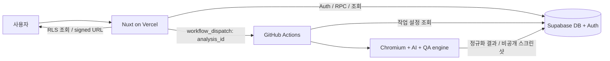

# Probe QA

URL을 등록하면 격리된 실행기가 페이지를 수집하고 AI 분석과 읽기 전용 QA 테스트를 수행하는 Nuxt 4 애플리케이션입니다. 운영 구조는 Vercel + GitHub Actions + Supabase이며, Vercel 함수에서는 Playwright·크롤링·AI 실행을 하지 않습니다.



## 로컬 개발

1. `.env.example`을 `.env`로 복사하고 Supabase 개발 프로젝트 값을 채웁니다.
2. `supabase/migrations/202608040001_initial_qa_schema.sql`을 적용합니다.
3. `npm install`, `npm run dev`를 실행합니다.
4. 실행기만 직접 확인하려면 `npm run qa:run -- --analysis-id=<uuid>`를 실행합니다.

기본 제한은 사이트 3페이지(최대 5), 깊이 1(최대 2), 자동 실행 8개, 사용자당 하루 5회, 전체 동시 실행 1개, 워크플로 10분입니다.

## 배포 문서

- [전체 배포](docs/DEPLOYMENT_VERCEL_GITHUB_SUPABASE.md)
- [Supabase](docs/SUPABASE_SETUP.md)
- [GitHub Actions 실행기](docs/GITHUB_ACTIONS_RUNNER.md)
- [Vercel](docs/VERCEL_SETUP.md)
- [무료 플랜 제한](docs/FREE_TIER_LIMITATIONS.md)

## 검증

```bash
npm run typecheck
npm test
npm run build
```

서비스 역할 키, GitHub 토큰, OpenAI 키는 절대 `NUXT_PUBLIC_` 변수나 Git 기록에 넣지 마세요.
